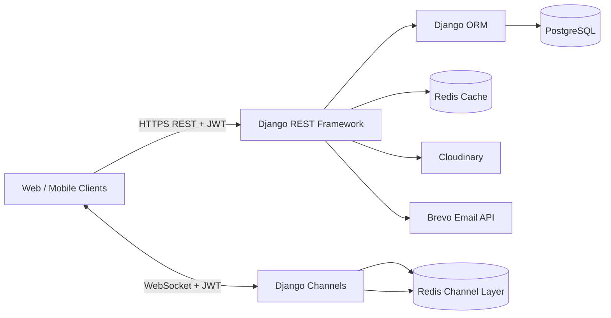

# EVENTRA BD — Backend

**A Django REST API backend for event planning, service discovery, booking, invoicing, reviews, and real-time notifications.**

EVENTRA BD is designed to connect customers with event-service providers (sellers). Sellers can publish a brand and event services, customers can submit hire requests, and both parties can manage the booking and invoice workflow.

> This repository contains the backend only. Frontend applications are maintained separately and are not included in this source archive.

## Table of contents

- [Core capabilities](#core-capabilities)
- [Technology stack](#technology-stack)
- [Architecture overview](#architecture-overview)
- [Django applications](#django-applications)
- [Getting started](#getting-started)
- [Environment configuration](#environment-configuration)
- [API overview](#api-overview)
- [Real-time notifications](#real-time-notifications)
- [Testing](#testing)
- [Documentation](#documentation)
- [Current implementation notes](#current-implementation-notes)

## Core capabilities

- **Role-based accounts:** customer, seller, and admin roles.
- **Email verification:** registration with a one-time password (OTP).
- **JWT authentication:** short-lived access tokens, rotating refresh tokens, refresh-token blacklisting, and separate client/admin refresh cookies.
- **Seller brands:** seller-owned event brands with slugs, portfolios, operating divisions, and rating summaries.
- **Service catalogue:** photography, videography, stage design, sound and lighting, and event-hall services.
- **Service packages:** package pricing and short feature lists for photography and videography.
- **Hire requests:** customers can request services, select booking options, and submit event-date and venue details.
- **Invoice workflow:** sellers create invoices for accepted hires; customers can agree or disagree.
- **Reviews and reports:** eligible customers can review or report completed services.
- **In-app notifications:** REST endpoints plus WebSocket push notifications.
- **Media management:** Cloudinary-backed profile, brand, service, review, and report images.
- **Operational controls:** pagination, throttling, custom permissions, model validation, and database constraints.

## Technology stack

| Area | Technology |
|---|---|
| Language | Python |
| Backend framework | Django 5.2.7 |
| REST API | Django REST Framework 3.16.1 |
| Authentication | Simple JWT 5.5.1 |
| Real-time communication | Django Channels 4.3.2 |
| WebSocket channel layer | channels-redis 4.3.0 |
| Cache / broker support | Redis |
| Relational database | PostgreSQL (`psycopg2-binary`, `dj-database-url`) |
| Media storage | Cloudinary |
| Email delivery | django-anymail with Brevo backend |
| ASGI server | Daphne 4.2.3 |
| WSGI server | Gunicorn 25.3.0 |
| Static files | WhiteNoise |
| Image processing | Pillow |

The dependency list also contains Celery and PyMongo. In the inspected source snapshot, Celery is configured but no task functions were found; no PyMongo/MongoDB usage was found. PostgreSQL is the configured application database.

## Architecture overview



The HTTP API is configured in `backend/urls.py`. WebSocket routing is configured in `backend/asgi.py` and `apps/notifications/routing.py`.

See [System Architecture](docs/02-system-architecture.md) for component responsibilities and sequence diagrams.

## Django applications

| App | Responsibility |
|---|---|
| `core` | Shared UID/timestamp models, standard response helpers, exception handling, and global middleware |
| `users` | Custom user model, registration, OTP verification, login, JWT refresh/logout, profile and admin user endpoints |
| `event_planner` | Seller-owned event brands and brand discovery |
| `event_services` | Public service catalogue, seller service management, galleries, suggestions, and admin service views |
| `packages` | Service packages and membership-based package limits |
| `hires` | Hire requests, booking items, booking slots, and seller decisions |
| `invoices` | Invoice creation, customer decisions, financial calculations, and per-slot shift records |
| `notifications` | Notification records, REST management, and WebSocket delivery |
| `reviews` | Hire-linked reviews and service/brand rating aggregates |
| `reports` | Customer service reports and admin moderation |
| `membership` | Basic, Pro, and Plus membership record |
| `orders` | Directory exists, but no order model, view implementation, or URL routes were found in this snapshot |

## Getting started

### Prerequisites

- Python version compatible with the pinned dependencies (Python 3.12 is a reasonable starting point; verify against your deployment runtime).
- PostgreSQL.
- Redis.
- A Cloudinary account for media uploads.
- A Brevo API key for email delivery.

### 1. Clone the repository

```bash
git clone https://github.com/SayedAnwar-07/eventrabd_backend.git
cd eventrabd_backend
```

### 2. Create and activate a virtual environment

**Windows PowerShell**

```powershell
py -m venv .venv
.venv\Scripts\Activate.ps1
```

**macOS / Linux**

```bash
python3 -m venv .venv
source .venv/bin/activate
```

### 3. Install dependencies

```bash
python -m pip install --upgrade pip
pip install -r requirements.txt
```

### 4. Configure environment variables

Create a local `.env` file from the example:

```bash
cp .env.example .env
```

On Windows PowerShell:

```powershell
Copy-Item .env.example .env
```

Fill in your own credentials. Never commit `.env`.

**Important implementation note:** the current `backend/settings.py` reads `SECRET_KEY` from the environment, but `DEBUG` is hardcoded to `True`. Change that setting to read the `DEBUG` environment variable before relying on `.env` to control debug mode.

### 5. Configure PostgreSQL

The application uses PostgreSQL-specific `ArrayField` functionality for brand operating divisions. PostgreSQL is therefore required; SQLite is not a drop-in replacement.

For local development, configure `DB_NAME`, `DB_USER`, `DB_PASSWORD`, `DB_HOST`, and `DB_PORT` in `.env`, and leave `DATABASE_URL` empty. When `DATABASE_URL` is supplied, the current settings parse it with `ssl_require=True`, which is suitable for SSL-enabled hosted databases but may need adjustment for local PostgreSQL.

### 6. Start Redis

Make sure Redis is running locally or provide a reachable Redis URL. Redis is used by the Channels layer and Django cache. Celery broker/result URLs are also configured, although no Celery tasks were found in the inspected source.

### 7. Apply migrations and create an admin account

```bash
python manage.py migrate
python manage.py createsuperuser
```

The custom user model uses email as the login identifier and requires a full name for superuser creation.

### 8. Run the ASGI application

For HTTP and WebSocket support, use Daphne:

```bash
daphne -b 127.0.0.1 -p 8000 backend.asgi:application
```

The Django development server can be used for basic HTTP-only development:

```bash
python manage.py runserver
```

For WebSocket testing, use the ASGI server and ensure Redis is running.

### 9. Useful commands

```bash
# Check Django configuration
python manage.py check

# Create migrations after model changes
python manage.py makemigrations

# Apply migrations
python manage.py migrate

# Collect static files
python manage.py collectstatic --noinput

# Run the test discovery command
python manage.py test
```

## Environment configuration

See [Environment Variables](docs/07-environment-variables.md) and `.env.example`.

At minimum, configure:

- `SECRET_KEY`
- `BREVO_API_KEY`
- `DEFAULT_FROM_EMAIL`
- `CLOUDINARY_CLOUD_NAME`
- `CLOUDINARY_API_KEY`
- `CLOUDINARY_API_SECRET`
- PostgreSQL connection settings
- Redis connection settings

## API overview

The project does not currently use a versioned API prefix. Main route groups:

| Prefix | Purpose |
|---|---|
| `/users/` | Authentication, profiles, admin user operations |
| `/event-planner/` | Brand discovery and management |
| `/event-services/` | Service discovery and management |
| `/packages/` | Service packages |
| `/hire/` | Hire and booking requests |
| `/invoices/` | Invoice operations |
| `/notifications/` | Notification REST endpoints |
| `/reviews/` | Reviews and eligibility |
| `/reports/` | Customer reports and admin moderation |
| `/admin/` | Django administration |

The complete route inventory, access notes, and example request bodies are in [API Reference](docs/05-api-reference.md).

## Real-time notifications

WebSocket endpoint:

```text
ws://localhost:8000/ws/notifications/?token=<ACCESS_TOKEN>
```

Use `wss://` in production. The current middleware reads the access token from the `token` query parameter. Query-string tokens can be captured in proxy or server logs; see the security review before production use.

A connected user joins a per-user channel group. The consumer sends notification events containing:

```json
{
  "type": "notification",
  "notification_id": "notification-id",
  "notification_type": "hire_created"
}
```

The client can then retrieve the full notification from the REST API.

## Testing

Each app has a `tests.py` file, but the inspected files contain only Django's default placeholder comment. No implemented automated test cases were found in this source snapshot.

Run:

```bash
python manage.py test
```

Before presenting the project as production-tested, add tests for authentication, role permissions, booking state transitions, invoice calculations, notification delivery, and review/report eligibility.

## Documentation

- [01 — Project Overview](docs/01-project-overview.md)
- [02 — System Architecture](docs/02-system-architecture.md)
- [03 — Technology Stack](docs/03-technology-stack.md)
- [04 — Project Structure](docs/04-project-structure.md)
- [05 — API Reference](docs/05-api-reference.md)
- [06 — Data Model](docs/06-data-model.md)
- [07 — Environment Variables](docs/07-environment-variables.md)
- [08 — Authentication and Authorization](docs/08-authentication-and-authorization.md)
- [09 — Business Workflows](docs/09-business-workflows.md)
- [10 — Local Development and Deployment](docs/10-development-and-deployment.md)
- [11 — Testing Strategy](docs/11-testing-strategy.md)
- [12 — Security Review and Known Gaps](docs/12-security-review-and-known-gaps.md)
